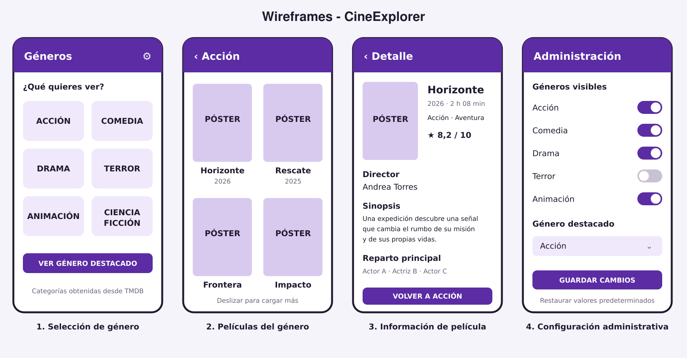
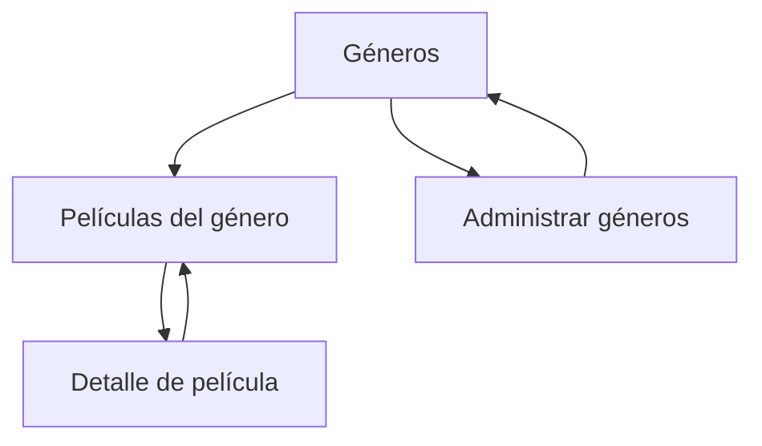

# CineExplorer

> Aplicación Android para explorar películas por género y consultar su información principal.
>
> **Autor:** Cristian Javier Jamaica
>
> **Curso:** Desarrollo de Aps Móviles (COM-437ES-AVO1)
>
> **Institución:** Saint Leo University
>
> **Versión actual:** 1.0.1
>
> **Última actualización:** 14 de octubre de 2026

## Tabla de contenido

1. [Descripción del proyecto](#descripción-del-proyecto)
2. [Exposición del problema](#exposición-del-problema)
3. [Objetivos](#objetivos)
4. [Fundamento técnico](#fundamento-técnico)
5. [Plataforma y tecnologías](#plataforma-y-tecnologías)
6. [Interfaz de usuario y administración](#interfaz-de-usuario-y-administración)
7. [Funcionalidad implementada](#funcionalidad-implementada)
8. [Integración con TMDB](#integración-con-tmdb)
9. [Diseño y wireframes](#diseño-y-wireframes)
10. [Arquitectura y estructura](#arquitectura-y-estructura)
11. [Instalación y ejecución](#instalación-y-ejecución)
12. [Pruebas](#pruebas)
13. [Registro de cambios](#registro-de-cambios)
14. [Alcance y trabajo pendiente](#alcance-y-trabajo-pendiente)
15. [Referencias](#referencias)

## Descripción del proyecto

**CineExplorer** es una aplicación Android que permite explorar películas a partir de sus géneros. La pantalla inicial presenta categorías cinematográficas como acción, aventura, animación, comedia, drama, terror y ciencia ficción. Cuando el usuario selecciona un género, la aplicación consulta y presenta las películas correspondientes en una cuadrícula. Al tocar una película, se abre una ficha con el título, año de estreno, géneros, director, sinopsis, reparto principal, duración, calificación y póster.

La información se obtiene exclusivamente de **The Movie Database (TMDB)** mediante su API y un token de lectura. La aplicación requiere conexión a Internet y permite descubrir películas reales por género. CineExplorer es informativa: no reproduce, descarga ni distribuye películas. La versión actual implementa el recorrido entre géneros, listado y detalle, además de una configuración local para controlar los géneros visibles.

## Exposición del problema

Las personas interesadas en el cine pueden tener dificultades para descubrir películas de un género específico y consultar rápidamente sus datos principales. Los buscadores generales suelen mezclar noticias, videos, publicidad, servicios de transmisión y otros contenidos. Como consecuencia, el usuario debe abrir varias páginas para conocer datos básicos como el año, el director o la sinopsis de una película.

CineExplorer atiende este problema mediante un recorrido directo: **seleccionar un género, consultar sus películas y abrir la ficha del título elegido**. Este enfoque reduce pasos innecesarios y organiza la información según una categoría que el usuario reconoce. La separación entre el repositorio de datos y la interfaz permite consultar el catálogo remoto sin incorporar la lógica de red a las pantallas.

La tesis que orienta el proyecto es que una navegación jerárquica y una presentación consistente de los datos reducen el esfuerzo requerido para explorar un catálogo cinematográfico. La interfaz aplica jerarquía visual, retroalimentación durante las consultas y mensajes recuperables ante los errores. Estas decisiones coinciden con los principios de visibilidad del estado del sistema, consistencia y prevención de errores propuestos por Nielsen (2024).

## Objetivos

### Objetivo general

Desarrollar en Android Studio una aplicación móvil que permita explorar películas por género y consultar información detallada de cada título mediante la API de TMDB.

### Objetivos específicos

- Consultar géneros y películas de TMDB mediante un token de lectura.
- Mostrar pósteres obtenidos de las rutas de imágenes devueltas por TMDB.
- Consultar las películas asociadas con el género seleccionado.
- Mostrar título, póster, año y calificación en cada tarjeta de película.
- Presentar una ficha con géneros, director, sinopsis, reparto, duración y calificación.
- Implementar navegación entre géneros, listado y detalle.
- Incluir estados de carga, error y ausencia de resultados.
- Permitir que una configuración administrativa local determine los géneros visibles.
- Mantener cualquier token de TMDB fuera del repositorio público.
- Documentar el avance mediante un registro de cambios verificable.

## Fundamento técnico

La solución adopta una separación entre interfaz, estado y acceso a datos. Android Developers (2026a) recomienda una arquitectura organizada por capas y un flujo de datos predecible para mejorar la capacidad de prueba y mantenimiento. Por esta razón, las pantallas de CineExplorer observan estados administrados por `ViewModel`, mientras que `MovieRepository` concentra el acceso a la API.

Jetpack Compose se utiliza para construir una interfaz declarativa. En este modelo, la pantalla representa el estado actual y vuelve a componerse cuando cambia la información (Android Developers, 2026b). Este principio facilita la representación explícita de cuatro condiciones importantes: carga, contenido disponible, ausencia de resultados y error recuperable.

Las preferencias de géneros se almacenan con DataStore. Esta biblioteca ofrece una API basada en corrutinas y flujos para persistir conjuntos pequeños de configuración (Android Developers, 2026c). `MovieRepository` centraliza las consultas a TMDB. La configuración local contiene únicamente las preferencias de géneros visibles y destacados.

## Plataforma y tecnologías

| Elemento | Selección | Uso en el proyecto |
|---|---|---|
| Plataforma | Android, API mínima 24 | Ejecución en teléfonos y emuladores Android |
| Entorno | Android Studio | Edición, compilación, emulación y depuración |
| Lenguaje | Kotlin | Lógica de la aplicación y modelos de datos |
| Interfaz | Jetpack Compose y Material 3 | Pantallas, tarjetas, cuadrículas y estados |
| Arquitectura | MVVM | Separación entre UI, estado y repositorio |
| Navegación | Navigation Compose | Flujo entre géneros, listado, detalle y administración |
| Red | Retrofit, OkHttp y corrutinas | Solicitudes HTTP y conversión de JSON |
| Imágenes | Coil | Carga de pósteres remotos |
| Preferencias | DataStore | Persistencia de géneros visibles y destacado |
| Control de versiones | Git y GitHub Classroom | Historial, publicación y entrega |

No se incorporan autenticación, Firebase, chat, pagos, reproducción de películas ni sincronización entre dispositivos. Estas funciones no son necesarias para demostrar el concepto central.

## Interfaz de usuario y administración

La interfaz sigue un flujo de tres niveles:

1. **Géneros:** categorías cinematográficas disponibles.
2. **Películas del género:** cuadrícula con póster, título, año y calificación.
3. **Detalle:** información ampliada de la película seleccionada.

La pantalla de administración es una configuración local, no un sistema de usuarios. Permite activar o desactivar géneros, marcar uno como destacado, guardar la selección y restaurar los valores predeterminados. Siempre se conserva al menos un género visible. La selección permanece en el dispositivo mediante DataStore.

Las consultas presentan un indicador de carga. Si falta el token, la aplicación informa que el acceso al catálogo no está configurado. Si la red falla o TMDB rechaza el acceso, se muestra un mensaje recuperable. Cada póster tiene sus propios estados de carga, éxito y error, con un botón para reintentar la imagen. Cuando TMDB no ofrece una ruta de póster, se indica expresamente.

## Funcionalidad implementada

### Funciones del usuario

- Consultar los géneros obtenidos de TMDB.
- Abrir un género y ver las películas asociadas.
- Cargar otra página de resultados sin duplicar las películas ya visibles.
- Consultar título, año, géneros, director, sinopsis, reparto, duración, calificación y póster.
- Regresar al listado o cambiar de género.
- Reintentar una consulta o un póster cuando ocurre un error.

### Funciones administrativas

- Consultar todos los géneros disponibles.
- Activar o desactivar géneros en la pantalla principal.
- Elegir un género destacado, que aparecerá primero.
- Guardar la configuración local.
- Restaurar todos los géneros.

### Reglas principales

- La pantalla inicial muestra únicamente los géneros activados.
- La selección de un género determina la consulta enviada a TMDB.
- Cada película se identifica mediante el identificador asignado por TMDB.
- Los directores se obtienen de los créditos cuyo trabajo es `Director`, sin duplicados.
- La ficha es informativa y no permite modificar los datos externos.
- El token de TMDB no se incluye en Git.
- Las consultas excluyen contenido para adultos.

## Integración con TMDB

CineExplorer utiliza la versión 3 de la API de TMDB. Retrofit transforma las respuestas JSON en modelos de Kotlin. Al abrir una película, el repositorio consulta sus detalles y créditos de forma concurrente para construir una sola ficha. El listado solicita páginas según el género seleccionado y el usuario puede pulsar **Cargar más** para obtener resultados adicionales.

Endpoints utilizados:

```text
GET https://api.themoviedb.org/3/genre/movie/list
GET https://api.themoviedb.org/3/discover/movie?with_genres={genre_id}
GET https://api.themoviedb.org/3/movie/{movie_id}
GET https://api.themoviedb.org/3/movie/{movie_id}/credits
```

El **API Read Access Token** se envía en el encabezado `Authorization: Bearer ...` conforme a la documentación de TMDB (s. f.-a). Se configura en `local.properties`, archivo excluido de Git mediante `.gitignore`. Si falta el token, no se sustituye el catálogo por datos de ejemplo.

La URL del póster se construye con la base `https://image.tmdb.org/t/p/w500` y el `poster_path` de cada película, siguiendo la guía de imágenes de TMDB (s. f.-b). El mismo constructor de URL se utiliza en el listado y en la ficha. Los valores nulos o vacíos representan una imagen ausente.

> Este producto utiliza la API de TMDB, pero no está respaldado ni certificado por TMDB.

## Diseño y wireframes

Los wireframes representan el recorrido principal y la configuración administrativa.





Criterios visuales aplicados:

- Tarjetas amplias y legibles para seleccionar géneros.
- Cuadrícula de dos columnas para los pósteres.
- Título del género seleccionado en la barra superior.
- Ficha organizada por datos técnicos, créditos y sinopsis.
- Soporte para tema claro, oscuro y colores dinámicos.
- Controles identificados para visibilidad y género destacado.

## Arquitectura y estructura

```text
CineExplorer/
├── app/src/main/java/com/example/cineexplorer/
│   ├── data/
│   │   ├── model/          # Respuestas de TMDB y modelos de dominio
│   │   ├── remote/         # Retrofit, OkHttp y endpoints
│   │   ├── MovieRepository.kt
│   │   └── SettingsRepository.kt
│   ├── ui/
│   │   ├── screen/         # Pantallas Compose
│   │   ├── state/          # Estados de carga, éxito y error
│   │   ├── theme/          # Colores y tema Material 3
│   │   └── viewmodel/      # Estado y acciones de cada pantalla
│   └── MainActivity.kt
├── docs/                   # Wireframes y pruebas manuales
├── CHANGELOG.md            # Registro de cambios ampliado
└── README.md               # Informe y guía del proyecto
```

El flujo principal de datos es `Pantalla → ViewModel → Repository → API`. Las respuestas regresan al `ViewModel`, se convierten en estado observable y Compose actualiza la pantalla. Las preferencias siguen el flujo `Pantalla administrativa → ViewModel → SettingsRepository → DataStore`.

## Instalación y ejecución

### Requisitos

- Android Studio con JDK 17.
- Android SDK 35 instalado.
- Un emulador o dispositivo con Android 7.0 (API 24) o superior.
- Una cuenta de TMDB y un **API Read Access Token** válido.
- Conexión a Internet en el emulador o dispositivo.

### Configuración

1. Clone o descargue este repositorio y ábralo en Android Studio.
2. Espere a que Gradle sincronice las dependencias.
3. Abra `local.properties` en la raíz del proyecto, conservando la línea `sdk.dir` creada por Android Studio.
4. Agregue su **API Read Access Token** de TMDB:

   ```properties
   TMDB_BEARER_TOKEN=su_token_de_lectura
   ```

5. Pegue únicamente el token: sin comillas y sin escribir `Bearer`.
6. Seleccione **File → Sync Project with Gradle Files**.
7. Detenga la aplicación anterior y pulse **Run** para recompilarla. El token se lee durante la compilación; editar el archivo sin recompilar no actualiza la aplicación instalada.

`local.properties.example` sirve como referencia y no contiene credenciales. El nombre de la propiedad debe ser exactamente `TMDB_BEARER_TOKEN`. Una **API Key** corta es una credencial diferente del **API Read Access Token** esperado por este proyecto.

### Pósteres y conexión

Los pósteres se descargan desde el servidor de imágenes de TMDB mediante Coil. El permiso `INTERNET` está declarado en el manifiesto. Si falla una imagen, pulse **Reintentar imagen**; si falla el catálogo completo, compruebe el token y la conexión. Algunas películas no tienen póster en TMDB y presentan un mensaje de imagen ausente.

### Solución al error de ruta con tildes en Windows

Si Android Studio muestra el mensaje `Your project path contains non-ASCII characters`, cierre el proyecto y muévalo a una ruta que no contenga tildes ni otros caracteres especiales, por ejemplo:

```text
C:\AndroidProjects\CineExplorer
```

Después, seleccione **File > Open**, abra la nueva carpeta y pulse **Sync Project with Gradle Files**. El proyecto también incluye `android.overridePathCheck=true` en `gradle.properties` como compatibilidad adicional, pero una ruta simple continúa siendo la opción más segura.

### Publicación final en GitHub

Desde la carpeta raíz del repositorio:

```bash
git add .
git commit -m "feat: publicar versión final de CineExplorer"
git push origin main
```

Después del envío, abra `README.md` en GitHub y copie su URL. Esa es la dirección que debe agregar al documento de entrega. Si la rama principal de GitHub Classroom tiene otro nombre, sustituya `main` por el nombre correspondiente.

## Pruebas

El proyecto incluye pruebas unitarias del mapeo de detalles y una lista de pruebas manuales en [`docs/PRUEBAS_MANUALES.md`](docs/PRUEBAS_MANUALES.md).

Comandos disponibles:

```bash
# Pruebas unitarias
./gradlew test

# Compilación de depuración
./gradlew assembleDebug
```

Las pruebas unitarias cubren el mapeo de detalles, textos alternativos, construcción de las URLs y películas con varios directores. Los casos manuales cubren token válido, token ausente, filtrado, pósteres, reintentos, paginación y persistencia.

**Estado de validación:** se revisaron las rutas de datos, el constructor de imágenes, la configuración de credenciales, los archivos y la integridad del ZIP. No se ejecutaron la compilación Android ni las pruebas JUnit en este entorno porque no dispone del SDK y no permite descargar Gradle. Deben ejecutarse en Android Studio con el token del estudiante; no se incluyen un APK ni resultados de pruebas no realizados.

## Registro de cambios

El registro sigue una adaptación de *Keep a Changelog* y utiliza versiones semánticas para diferenciar el borrador, el avance funcional y la entrega estable.

### Actual — [1.0.1] — 14 de octubre de 2026

**Corregido**

- TMDB vuelve a ser la única fuente de películas, géneros y detalles.
- Se retiró el catálogo ficticio que provocaba pósteres vacíos.
- Se normaliza el token al leer `local.properties`.
- Las imágenes tienen indicador de carga, mensaje de ausencia y reintento.
- La ficha muestra todos los directores, sin duplicados.
- Se actualizó el Gradle Wrapper a 8.13.

**Agregado**

- Pruebas de regresión para las URLs de pósteres y los directores.
- Instrucciones para configurar el token y recompilar la aplicación.

### Pasado — [1.0.0] — 14 de octubre de 2026

**Agregado**

- Catálogo local con ocho películas y siete géneros.
- Ejecución completa sin cuenta, token ni conexión a Internet.
- Pruebas unitarias para el catálogo incluido.
- Presentación alternativa cuando una película no tiene póster.

**Cambiado**

- TMDB pasó a ser una fuente de datos opcional.
- La versión de la aplicación se actualizó a `1.0.0`.
- La instalación, las pruebas y la documentación reflejan la entrega final.

**Verificado**

- Estructura del proyecto, exclusiones de Git y ausencia de credenciales en el código.
- Coherencia entre el flujo Géneros → Películas → Detalle y los wireframes.

### Pasado — [0.2.1] — 22 de septiembre de 2026

**Corregido**

- Compatibilidad con rutas de Windows que contienen caracteres no ASCII.
- Procedimiento recomendado para mover el proyecto a una ruta sin tildes.

### Pasado — [0.2.0] — 22 de septiembre de 2026

**Agregado**

- Proyecto Android Studio con Kotlin, Jetpack Compose y arquitectura MVVM.
- Pantallas de géneros, listado, detalle y administración.
- Integración con TMDB, paginación, pósteres y manejo de errores.
- Preferencias locales mediante DataStore.

### Pasado — [0.1.0] — 26 de agosto de 2026

**Agregado**

- Definición del problema, objetivos, plataforma y alcance.
- Diseño del flujo Géneros → Películas → Detalle.
- Wireframes de las cuatro pantallas principales.

### Trabajo posterior a la entrega

- Mejorar la caché del catálogo para consultas sin conexión.
- Incorporar pruebas instrumentadas de navegación.
- Revisar la accesibilidad en diferentes tamaños de pantalla.
- Agregar búsqueda y favoritos en una versión futura.

## Alcance y trabajo pendiente

La versión final permite seleccionar un género, consultar sus películas y abrir una ficha con información de TMDB, una vez configurado el token de lectura. La administración de géneros se guarda localmente. El proyecto integra navegación, transformación de JSON, carga de imágenes, paginación, arquitectura MVVM, persistencia y manejo de errores.

Las funciones de búsqueda, favoritos, recomendaciones, cuentas y sincronización permanecen fuera de la versión final porque no son necesarias para cumplir el objetivo académico principal.

## Referencias

Android Developers. (2026a). *Guide to app architecture*. https://developer.android.com/topic/architecture

Android Developers. (2026b). *Thinking in Compose*. https://developer.android.com/develop/ui/compose/mental-model

Android Developers. (2026c). *DataStore*. https://developer.android.com/topic/libraries/architecture/datastore

Android Developers. (2026d). *Use a Bill of Materials*. https://developer.android.com/develop/ui/compose/bom

GitHub. (s. f.). *Hola mundo*. https://docs.github.com/es/get-started/start-your-journey/hello-world

Keep a Changelog. (s. f.). *Keep a changelog*. https://keepachangelog.com/es-ES/1.1.0/

Nielsen, J. (2024). *10 usability heuristics for user interface design*. Nielsen Norman Group. https://www.nngroup.com/articles/ten-usability-heuristics/

Sánchez Hernández, J. J. (s. f.). *Taller de introducción a Git y GitHub*. GitHub. https://github.com/josejuansanchez/taller-git-github

Square. (s. f.). *Retrofit: A type-safe HTTP client for Android and Java*. https://square.github.io/retrofit/

The Movie Database. (s. f.-a). *Application authentication*. https://developer.themoviedb.org/docs/authentication-application

The Movie Database. (s. f.-b). *Image basics*. https://developer.themoviedb.org/docs/image-basics

The Movie Database. (s. f.-c). *Getting started*. https://developer.themoviedb.org/docs/getting-started

The Movie Database. (s. f.-d). *Movie credits*. https://developer.themoviedb.org/reference/movie-credits
